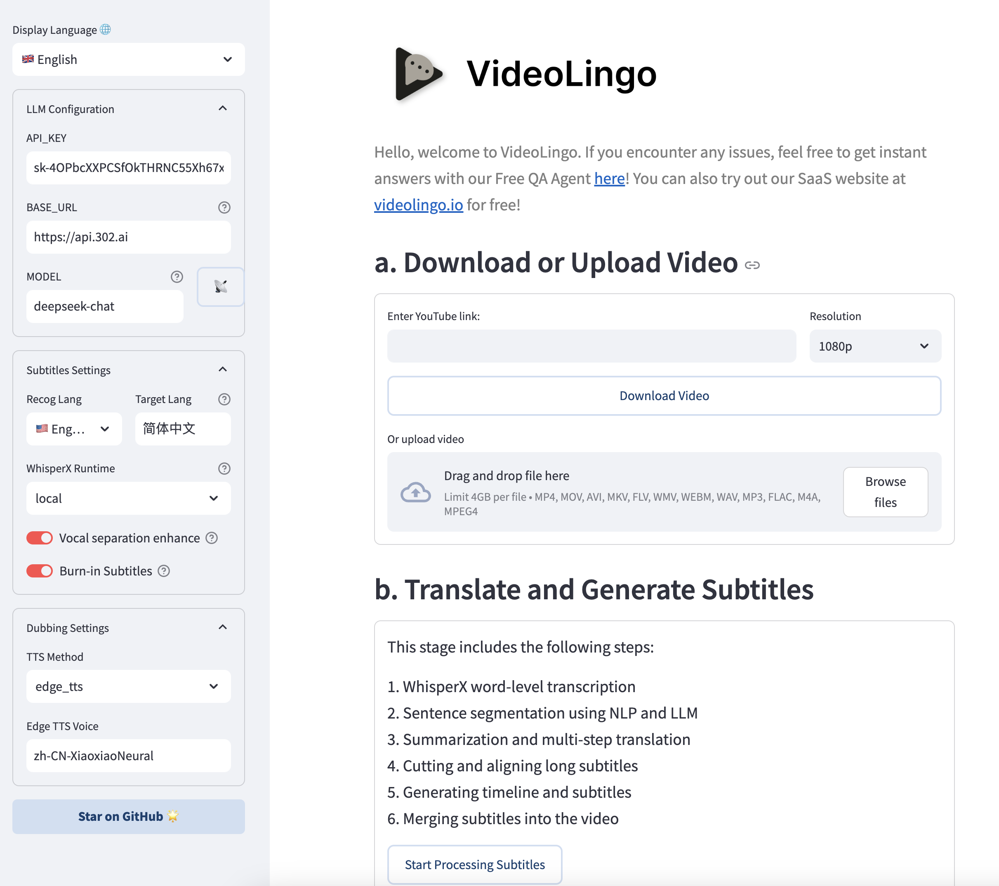

# 🚀 Getting Started

## 📋 API Configuration
VideoLingo requires an LLM and TTS (optional). For the best quality, use claude-3-5-sonnet-20240620. For dubbing, custom_tts offers a user-implementable hook for any TTS service; this fork ships no built-in TTS backend.

### 1. **Get API_KEY for LLM**:

| Recommended Model | Recommended Provider | base_url | Price | Effect |
|:-----|:---------|:---------|:-----|:---------|
| claude-3-5-sonnet-20240620 | [yunwu.ai](https://yunwu.ai/register?aff=TXMB) | https://yunwu.ai | $1 / 1M tokens | 🤩 |
| gpt-4.1 | [yunwu.ai](https://yunwu.ai/register?aff=TXMB) | https://yunwu.ai | $0.5 / 1M tokens | 🤩 |
| gemini-2.0-flash | [302AI](https://gpt302.saaslink.net/C2oHR9) | https://api.302.ai | $0.3 / 1M tokens | 😃 |
| deepseek-v3 | [302AI](https://gpt302.saaslink.net/C2oHR9) | https://api.302.ai | $1 / 1M tokens | 🥳 |
| qwen2.5-coder:32b | [Ollama](https://ollama.ai) | http://localhost:11434 | 0 | 😃 |

Note: Supports OpenAI format, you can try different models at your risk. However, the process involves multi-step reasoning chains and complex JSON formats, **not recommended to use models smaller than 30B**.

### 2. **TTS API**
VideoLingo ships no built-in dubbing backend (skip if only using translation without dubbing):

- **custom_tts**: User-implementable hook for integrating any TTS service. See `core/tts_backend/custom_tts.py`.

## 🛠️ Quick Start

VideoLingo supports Windows, macOS and Linux systems, and can run on CPU or GPU.

> **Note:** To use NVIDIA GPU acceleration on Windows, please complete the following steps first:
> 1. Install [CUDA Toolkit 12.6](https://developer.download.nvidia.com/compute/cuda/12.6.0/local_installers/cuda_12.6.0_560.76_windows.exe)
> 2. Install [CUDNN 9.3.0](https://developer.download.nvidia.com/compute/cudnn/9.3.0/local_installers/cudnn_9.3.0_windows.exe)
> 3. Add `C:\Program Files\NVIDIA\CUDNN\v9.3\bin\12.6` to your system PATH
> 4. Restart your computer

> **Note:** FFmpeg is required. Please install it via package managers:
> - Windows: ```choco install ffmpeg``` (via [Chocolatey](https://chocolatey.org/))
> - macOS: ```brew install ffmpeg``` (via [Homebrew](https://brew.sh/))
> - Linux: ```sudo apt install ffmpeg``` (Debian/Ubuntu) or ```sudo dnf install ffmpeg``` (Fedora)

Before installing VideoLingo, ensure you have installed Git and Anaconda.

1. Clone the project:
   ```bash
   git clone https://github.com/Huanshere/VideoLingo.git
   cd VideoLingo
   ```

2. Create and activate virtual environment (**must be python=3.10.0**):
   ```bash
   conda create -n videolingo python=3.10.0 -y
   conda activate videolingo
   ```

3. Run installation script:
   ```bash
   python install.py
   ```

4. 🎉 Launch Streamlit app:
   ```bash
   streamlit run st.py
   ```

5. Set key in sidebar of popup webpage and start using~

   

6. (Optional) More settings can be manually modified in `config.yaml`, watch command line output during operation. To use custom terms, add them to `custom_terms.xlsx` before processing, e.g. `Baguette | French bread | Not just any bread!`.

> Need help? Our [AI Assistant](https://share.fastgpt.in/chat/share?shareId=066w11n3r9aq6879r4z0v9rh) is here to guide you through any issues!

## 🏭 Batch Mode (beta)

Document: [English](/batch/README.md) | [Chinese](/batch/README.zh.md)

Note: This section is still in early development and may have limited functionality

## 🚨 Common Errors

1. **'All array must be of the same length' or 'Key Error' during translation**: 
   - Reason 1: Weaker models have poor JSON format compliance causing response parsing errors.
   - Reason 2: LLM may refuse to translate sensitive content.
   Solution: Check `response` and `msg` fields in `output/gpt_log/error.json`, delete the `output/gpt_log` folder and retry.

2. **'Retry Failed', 'SSL', 'Connection', 'Timeout'**: Usually network issues. Solution: Users in mainland China please switch network nodes and retry.

3. **local_files_only=True**: Model download failure due to network issues, need to verify network can ping `huggingface.co`.
